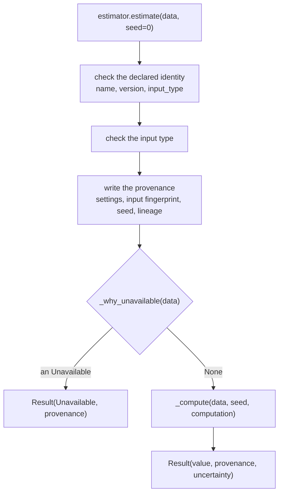
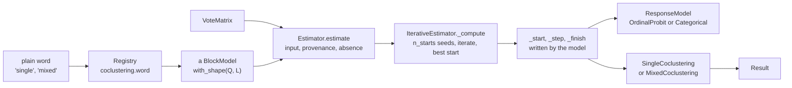

# Architecture

This page describes how the engine is built: the contract every method shares, the data of co-clustering, and the pipeline a block model runs through. It is written for whoever adds a method or reviews one. The mathematical definition of each method lives in its docstring.

## Six rules

1. **An estimator is a frozen value.** Every setting is a named, typed field of a frozen dataclass; nothing is read from the environment. `estimate(data, *, seed=0)` is written once, in `Estimator`, and is never overridden.
2. **Every result is a `Result`.** It carries a value or an explained absence (`Unavailable`), the provenance, and the uncertainty when the method defines one. Never `None`, never NaN, never a default in place of an absence.
3. **Determinism.** Same data, same settings, same seed: same result and same fingerprint. Any randomness goes through the seed received.
4. **Dependencies.** The package root and `ordinal` import the standard library only. `blocks` imports NumPy and raises `MissingExtraError` when it is missing. No module imports the `civiqhub` SDK, a network client or a storage layer.
5. **Extension without modification.** A new method is a class declared under the entry-point group `civiqhub_selene.estimators`, with a key `family.choice`. It passes the contract kit. No existing class is modified.
6. **Three states per cell.** In a vote matrix, a cell is voted, shown without a vote, or not shown. An empty cell is never a zero nor a neutral answer.

## Modules

| Module | Holds | Imports |
| --- | --- | --- |
| `civiqhub_selene.errors` | `SeleneError` and its seven subclasses; each carries a `hint` | standard library |
| `civiqhub_selene.types` | `Result`, `Unavailable`, `Provenance`, `Method`, `Randomness`, `StandardError`, `Interval`, `Displayable` | standard library |
| `civiqhub_selene.estimator` | `Estimator`, `Fingerprinted` | standard library |
| `civiqhub_selene.registry` | `Registry`, `EstimatorSpec`, `default_registry` | standard library |
| `civiqhub_selene.testing` | `EstimatorContract`, `fingerprint_of` | standard library; pytest when a test runs |
| `civiqhub_selene.ordinal.counts` | `VoteCounts`, `SCORES` | standard library |
| `civiqhub_selene.blocks.data` | `OrdinalScale`, `Vote`, `VoteMatrix`, `GroupedVotes` | NumPy |
| `civiqhub_selene.blocks.partition` | `Partition`, `VoterGroup`, `ItemBlock` | NumPy |
| `civiqhub_selene.blocks.coclusters` | `Cocluster`, `CoclusterTable` | NumPy |
| `civiqhub_selene.blocks.synthetic` | `make_votes`, `PlantedTruth`, `single_memberships` | NumPy |
| `civiqhub_selene.blocks.responses` | `ResponseModel`, `Categorical`, `OrdinalProbit` | NumPy |
| `civiqhub_selene.blocks._numerics` | `count_states`, `logsumexp`, the normal law, `iterate`, `History`, `fit_latent_normal` | NumPy |
| `civiqhub_selene.blocks.iterative` | `IterativeEstimator`, `HasObjective` | NumPy |
| `civiqhub_selene.blocks.base` | `CoclusteringEstimator`, `BlockModel`, `availability`, `estimator_for`, `memberships` | NumPy |
| `civiqhub_selene.blocks.single` | `LatentBlockModel`, the single-membership block model | NumPy |
| `civiqhub_selene.blocks.results` | `Coclustering`, `SingleCoclustering`, `MixedCoclustering`, `Selection`, `HasIntegratedLikelihood`, `PredictsVotes` | NumPy |

Not written yet: the dissensus index and the collective regime (`ordinal`), the mixed-membership block model (`MixedMembershipBlockModel`), the choice of shape (`select_shape`), the consensus between groups and the `cocluster` function.

## The contract of a method



A concrete method is a frozen dataclass declared with `kw_only=True`. It declares `name`, `version`, `reference` and `input_type` as class attributes and writes `_compute`. It never builds a `Result` nor a `Provenance` itself.

`Result.fingerprint()` identifies the computation: method name and version, settings, seed, input fingerprint and lineage. The engine version and the versions of dependencies are recorded but left out of the fingerprint.

To prove that an estimator honours the contract, write three methods and inherit seven tests:

```python
from civiqhub_selene.testing import EstimatorContract


class TestMyMethod(EstimatorContract):
    def make_estimator(self):
        return MyMethod()

    def make_data(self):
        return ...  # an input on which a value exists

    def make_empty_data(self):
        return ...  # an input with no answer, or None if there is none
```

## The data of co-clustering

A group gathers voters, a block gathers items, and a co-cluster is the pair of a group and a block.

- `VoteMatrix` holds `levels` (0: no vote; `k`: vote at rank `k` of the scale) and `shown`. Models read it through `votes._states()` only: an indicator array of shape (M, P, K + 1), zero everywhere on a cell that is not shown.
- `Partition` arranges identifiers in clusters. It can come from a model or from anywhere else, and carries the fingerprint of the computation it comes from.
- `GroupedVotes` reads a matrix through a partition of voters and a partition of items. `counts()` gives the sufficient statistic of every block model: the number of shown cells of each co-cluster in each state, shape (Q, L, K + 1).
- `CoclusterTable` summarises each co-cluster by a vote rate and a distribution of the answers.

## The pipeline of a block model

A block model is a latent structure (who belongs to which group, which item to which block) and a response model, which says how the cells of a co-cluster spread between "shown without a vote" and each score. The two are independent: any block model runs with any response model.



```text
Estimator                      estimate()     written once
|- IterativeEstimator          _compute()     written once
'- CoclusteringEstimator       with_shape(), availability
BlockModel(IterativeEstimator, CoclusteringEstimator)
|- LatentBlockModel            "single"
'- MixedMembershipBlockModel   "mixed"        to come
```

What is written once:

- `Estimator.estimate` checks the input, writes the provenance and wraps the outcome.
- `CoclusteringEstimator._why_unavailable` returns an explained absence when the matrix holds no vote, or fewer voters or items with a vote than the shape asks for.
- `IterativeEstimator._compute` derives one seed per start with `numpy.random.SeedSequence(seed).spawn(n_starts)`, runs every start with `iterate`, the only convergence loop of the package, and keeps the start whose final objective is the largest.

What a model writes: its identity, and three hooks.

<!-- not run: a skeleton, the state and the body of the hooks are yours to write -->

```python
@dataclass(frozen=True, kw_only=True)
class MyBlockModel(BlockModel[MyState, SingleCoclustering]):
    name = "my_block_model"
    version = "0.1.0"
    reference = "Author, year."
    # The plain word of the registry key, and its meaning in plain words.
    membership = "mine"
    meaning = "each voter belongs to one group"
    default_criterion = "integrated_likelihood"

    def _start(self, votes, rng):
        """Return a starting state, drawn with rng only. Called once per start."""

    def _step(self, votes, state):
        """Return the state after one full iteration. It must not lower state.objective."""

    def _finish(self, votes, state, history, computation):
        """Return the public value, from the best final state."""
```

A state is any frozen object with an `objective`. A model never writes a loop and never draws a seed. `civiqhub_selene/blocks/single.py` is the model to read first: `LatentBlockModel` is these three hooks and nothing else. `tests/unit/test_blocks_pipeline.py` holds a shorter model written with the public pieces only; it is a test of the architecture, not a delivered method.

A step uses the response model through four calls:

| Call | Returns |
| --- | --- |
| `response_model.initial_parameters((Q, L), votes, rng)` | starting parameters |
| `response_model.update(counts, parameters)` | the parameters the counts call for; `counts` has shape (Q, L, K + 1), integer or fractional |
| `response_model.log_probabilities(parameters)` | the log-probability of each state in each co-cluster, shape (Q, L, K + 1) |
| `response_model.to_table(parameters, counts, votes.scale)` | the `CoclusterTable` of the value |

`complexity_penalty((Q, L), votes)` gives the penalty of the response model in the integrated likelihood.

## Adding a method

1. Write the estimator and its value in their module, with the mathematical definition and the reference in the docstring.
2. Declare it in `pyproject.toml`, then reinstall the package: an editable install reads its entry points when it is installed. For example, the line of the single-membership model:

   ```toml
   [project.entry-points."civiqhub_selene.estimators"]
   "coclustering.single" = "civiqhub_selene.blocks.single:LatentBlockModel"
   ```

3. Add a test class that inherits `EstimatorContract`, unit tests on known cases, property-based tests for the invariants, and reference vectors under `tests/vectors` with their tolerance.
4. Create the page of its module in the reference. `docs/README.md`, in the repository, says how; a test fails as long as a public module has no page.

## Tests

| Suite | Content |
| --- | --- |
| `tests/unit` | One file per module, on small hand-written inputs |
| `tests/property` | Invariants on generated inputs, with Hypothesis; the profile in `conftest.py` has no deadline and is derandomised |
| `tests/vectors` | Expected values stored as data, with their tolerance and their source |
| `tests/contract` | Reserved for the contract between the engine and the service |

Two files of `tests/unit` check the documentation: `test_docs_reference.py` (every public module has a page in the reference) and `test_docs_examples.py` (every Python block of the pages runs and prints the output shown).

A test file of the `blocks` extra is marked and skips itself when NumPy is missing:

```python
import pytest

pytest.importorskip("numpy")

import numpy as np

from civiqhub_selene.blocks import VoteMatrix

pytestmark = pytest.mark.blocks
```

The `test-core` job of the CI installs the package without any extra, checks that NumPy is not installed, and runs `pytest -m "not blocks"`: the package root and `ordinal` must live without NumPy.

## Words

| Word | Meaning |
| --- | --- |
| score | The answer of a vote on the agreement scale: an integer from -2 to +2 |
| level | The rank of a score on the scale, from 1 to K; 0 means "no vote". Internal to matrices |
| voter, item | The row and the column of a vote matrix, by opaque identifiers |
| shown | The item was shown to the voter |
| group, block | A cluster of voters; a cluster of items |
| co-cluster | The pair of a group and a block |
| membership | The degree to which a voter belongs to each group, or an item to each block; also the choice `"single"` or `"mixed"` |
| fingerprint | A stable identifier of a content or of a computation: 16 hexadecimal characters of a SHA-256 |
| computation | The fingerprint of one precise computation: method, settings, seed, input, lineage |
