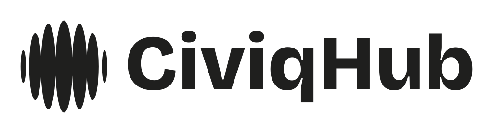

# SELENE

SELENE is the open-source scientific engine of [CiviqHub](https://civiqhub.com) for analysing collective deliberation. `civiqhub-selene` is its Python library: deterministic computations on explicit inputs, with no network access and no dependency on CiviqHub services.

A result describes a group and decides nothing. Every result carries its value or an explained absence, and the provenance that lets anyone compute it again.

## What the library holds

| Part | Holds | Needs |
| --- | --- | --- |
| [`civiqhub_selene`](reference/civiqhub_selene.md) | The contract every method shares: errors, results with their provenance, the base class of estimators, the registry, the contract kit | The standard library |
| [`civiqhub_selene.ordinal`](reference/civiqhub_selene.ordinal.md) | The ordinal reading of the votes on one item | The standard library |
| [`civiqhub_selene.blocks`](reference/civiqhub_selene.blocks.md) | Co-clustering: groups of voters and blocks of items that vote alike, with one group per voter or mixed memberships, from a random or a spectral start | NumPy, behind the `blocks` extra |
| [`civiqhub_selene.viz`](reference/civiqhub_selene.viz.md) | Co-clustering results as NetworkX graphs, and their figures | NetworkX and Matplotlib, behind the `viz` extra |

## Démarrer

```{raw} html
<div class="civiqhub-cards">
  <a class="civiqhub-card" href="getting-started.html">
    <div class="civiqhub-card-banner">
      
      
    </div>
    <div class="civiqhub-card-body">
      <span class="civiqhub-card-title">Premiers pas</span>
      <p>Installez la bibliothèque et lancez un premier calcul, sur des données synthétiques.</p>
    </div>
  </a>
  <a class="civiqhub-card" href="library-map.html">
    <div class="civiqhub-card-banner">
      
      
    </div>
    <div class="civiqhub-card-body">
      <span class="civiqhub-card-title">Plan de la bibliothèque</span>
      <p>Trouvez le module qui tient ce dont vous avez besoin, et la page qui le documente.</p>
    </div>
  </a>
  <a class="civiqhub-card" href="architecture.html">
    <div class="civiqhub-card-banner">
      
      
    </div>
    <div class="civiqhub-card-body">
      <span class="civiqhub-card-title">Architecture</span>
      <p>Comment le moteur est construit, et comment y ajouter une méthode.</p>
    </div>
  </a>
  <a class="civiqhub-card" href="examples.html">
    <div class="civiqhub-card-banner">
      
      
    </div>
    <div class="civiqhub-card-body">
      <span class="civiqhub-card-title">Exemples</span>
      <p>Des notebooks qui chargent des votes, lancent l'OLBM et le MM-OLBM et dessinent les résultats.</p>
    </div>
  </a>
  <a class="civiqhub-card" href="model/index.html">
    <div class="civiqhub-card-banner">
      
      
    </div>
    <div class="civiqhub-card-body">
      <span class="civiqhub-card-title">Modèle mathématique</span>
      <p>Les formules que le code calcule, leur notation, et les lignes du code qui les calculent.</p>
    </div>
  </a>
  <a class="civiqhub-card" href="reference/index.html">
    <div class="civiqhub-card-banner">
      
      
    </div>
    <div class="civiqhub-card-body">
      <span class="civiqhub-card-title">Référence de l'API</span>
      <p>Chaque nom public, généré depuis les docstrings du code.</p>
    </div>
  </a>
</div>
```

```{toctree}
:hidden:
:caption: Guide

Accueil <self>
Premiers pas <getting-started>
Plan de la bibliothèque <library-map>
Architecture <architecture>
Exemples <examples>
```

```{toctree}
:hidden:
:caption: Mathematical model

Overview <model/index>
Notation <model/notation>
The data <model/data>
```

```{toctree}
:hidden:
:caption: Référence

Référence de l'API <reference/index>
Journal des versions <changelog>
```

```{toctree}
:hidden:
:caption: Projet

Code source <https://github.com/civiqhub/civiqhub-selene>
Contribuer <https://github.com/civiqhub/civiqhub-selene/blob/develop/CONTRIBUTING.md>
Licence <https://github.com/civiqhub/civiqhub-selene/blob/develop/LICENSE>
```
